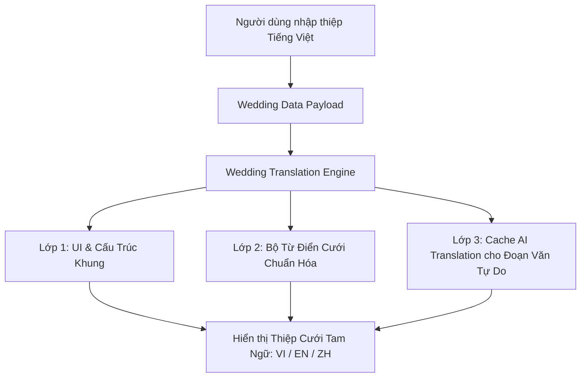

# Kế Hoạch Triển Khai Đa Ngôn Ngữ (i18n) Toàn Diện Cho Thiệp Cưới Mẫu (VI - EN - ZH)

## Context
- **Hiện trạng:** Hệ thống đã có `LanguageSwitcher` (VI, EN, ZH) và từ điển `fe/src/config/i18n.ts` cho các trang landing/marketing. Tuy nhiên, toàn bộ các mẫu thiệp cưới (`WeddingView`, `WeddingCoverOpening`, `InteractiveCalendarGrid`, `Template10NhaCoHy`, `Template11SageGardenGlass`, `Template12RoyalCrimson`, `WeddingSceneRenderer`, `CanvasElementContent`, `WeddingPassSection`, `Wedding3DFlipbook`, `RsvpFormModal`, `GiftQrBoxModal`, `GuestbookSection`) đều đang bị hardcode tiếng Việt.
- **Yêu cầu người dùng:** Người dùng chỉ cần tạo thiệp và nhập thông tin bằng Tiếng Việt. Khi tạo xong hoặc khi gửi link cho khách mời, bất cứ ai chuyển sang tiếng Anh (EN) hoặc tiếng Trung (ZH) đều thấy thiệp được chuyển ngữ hoàn chỉnh, tự nhiên và sang trọng.
- **Phương án đã chốt:** Phương án A — Tự động dịch 100% cấu trúc giao diện, sự kiện, vai vế bằng Bộ Từ Điển Cưới Tam Ngữ chuyên sâu; đồng thời hỗ trợ AI Translation Service (Google Gemini) dịch các đoạn văn tự do (lời ngỏ riêng, chuyện tình yêu) và cache vào `categoryData.translations: { en: {...}, zh: {...} }`.

---

## Approach

Kiến trúc chuyển ngữ gồm 3 lớp đồng bộ:



1. **Lớp 1 — UI & Cấu Trúc Khung (100% Dictionary-based i18n):**
   - Mở rộng [fe/src/config/i18n.ts](file:///d:/freelancer/WebsiteThiep/fe/src/config/i18n.ts) với đầy đủ bộ từ khóa cho thiệp cưới (Bìa sáp mở thiệp, Đếm ngược ngày cưới, Tờ lịch tương tác, Lịch trình ngày cưới, Dresscode, Album ảnh, Vé cưới Boarding pass, Sổ lưu bút, Modal RSVP, Modal Hộp mừng VietQR).
   - Tích hợp `useLanguage()` vào tất cả các component giao diện thiệp cưới.

2. **Lớp 2 — Bộ Chuyển Ngữ Cưới Chuyên Sâu ([wedding-translator.ts](file:///d:/freelancer/WebsiteThiep/fe/src/lib/i18n/wedding-translator.ts)):**
   - Module xử lý tự động quy đổi các trường tiếng Việt sang tiếng Anh và tiếng Trung:
     - **Thứ bậc gia đình:** `Trưởng nam` ➔ `Eldest Son` ➔ `长子/长男`; `Út nữ` ➔ `Youngest Daughter` ➔ `幼女`; `Thứ nam` ➔ `Second Son` ➔ `次子`; `Trưởng nữ` ➔ `Eldest Daughter` ➔ `长女`; `Con một` ➔ `Only Child` ➔ `独生子女`.
     - **Gia tộc & Phụ mẫu:** `Nhà Trai` ➔ `Groom's Family` ➔ `男方家庭`; `Nhà Gái` ➔ `Bride's Family` ➔ `女方家庭`; `Đại diện nhà trai` ➔ `Groom's Parents` ➔ `男方代表`; `Ông` ➔ `Mr.` ➔ `父亲`; `Bà` ➔ `Mrs.` ➔ `母亲`.
     - **Sự kiện cưới:** `Lễ Thành Hôn` ➔ `Wedding Ceremony` ➔ `结婚典礼`; `Tiệc Cưới` ➔ `Wedding Banquet / Reception` ➔ `婚宴/喜宴`; `Lễ Vu Quy` ➔ `Bride's Send-off Ceremony` ➔ `出阁之礼`; `Lễ Tân Hôn` ➔ `Groom's Welcome Ceremony` ➔ `迎亲之礼`; `Lễ Báo Hỷ` ➔ `Wedding Announcement Banquet` ➔ `答谢宴`; `Lễ Đính Hôn` ➔ `Engagement Ceremony` ➔ `订婚典礼`; `Tư gia` ➔ `Private Residence` ➔ `男方/女方家中`.
     - **Ngày giờ & Lịch:** Thứ trong tuần (T2...CN ➔ Mon...Sun ➔ 一...日); Định dạng ngày tháng chuẩn; Chuyển ngữ lịch âm (`Tức ngày...` ➔ `Lunar date: ...` ➔ `农历: ...`).
     - **Châm ngôn & Câu chúc mẫu:** Ánh xạ tự động các câu chúc quen thuộc (*"Trăm năm tình viên mãn..."*, *"Tình yêu không phải là nhìn nhau..."*, *"Trân trọng kính mời quý khách..."*) sang bản dịch tiếng Anh và tiếng Trung trau chuốt.

3. **Lớp 3 — AI Translation Engine (Backend & Fallback Client):**
   - Backend [be/src/services/ai-translate.service.ts](file:///d:/freelancer/WebsiteThiep/be/src/services/ai-translate.service.ts): Tận dụng Google Gemini API (`gemini-flash-latest` đã tích hợp) dịch tự động các trường văn bản tự do (`greeting`, `loveStory[].description`, `story`, `note`) khi người dùng lưu thiệp, kết quả ghi vào `card.categoryData.translations: { en: {...}, zh: {...} }`.
   - Frontend [wedding-translator.ts](file:///d:/freelancer/WebsiteThiep/fe/src/lib/i18n/wedding-translator.ts): Ưu tiên lấy từ `card.categoryData.translations[lang]`, nếu chưa có sẽ fallback sang Lớp 2 (Bộ từ điển chuẩn hóa) đảm bảo không bao giờ bị lỗi giao diện.

---

## Key Decisions

1. **Không bắt buộc người dùng nhập 3 thứ tiếng khi tạo thiệp:** Giữ trải nghiệm tạo thiệp đơn giản, nhanh gọn trong 5 phút. Toàn bộ việc chuyển ngữ được thực hiện tự động ngầm.
2. **Ưu tiên Client-side Mapping cho các trường chuẩn:** Giúp tốc độ đổi ngôn ngữ tức thì (0ms latency, không phụ thuộc mạng hay API limit), chỉ gọi AI cho các đoạn văn custom dài.
3. **Bảo toàn tên riêng người:** Tên Cô dâu & Chú rể, Tên Cha Mẹ được giữ nguyên vẹn danh tính cá nhân (hoặc hỗ trợ bỏ dấu nếu hiển thị tiếng Anh typography không hỗ trợ dấu).
4. **Không làm thay đổi cấu trúc bảng cơ sở dữ liệu:** Lưu trữ trực tiếp trong trường `categoryData.translations` dạng JSONB có sẵn của bảng `cards`, đảm bảo an toàn tuyệt đối và không cần chạy Prisma migration phức tạp.

---

## Data Model & Types

### 1. Cấu trúc trường `translations` trong `categoryData` (Frontend & Backend)
```typescript
export interface WeddingTranslatedContent {
  greeting?: string;
  heroSubtitle?: string;
  invitationTitle?: string;
  groom?: {
    birthOrder?: string;
    story?: string;
  };
  bride?: {
    birthOrder?: string;
    story?: string;
  };
  events?: Array<{
    id?: string;
    eventName?: string;
    venueName?: string;
    lunarDate?: string;
    address?: string;
  }>;
  loveStory?: Array<{
    title?: string;
    description?: string;
  }>;
}

export interface WeddingDataPayloadWithTranslations extends WeddingDataPayload {
  translations?: {
    en?: WeddingTranslatedContent;
    zh?: WeddingTranslatedContent;
  };
}
```

---

## Files to Modify

### 1. Từ điển & Engine dịch thuật Frontend
- [fe/src/config/i18n.ts](file:///d:/freelancer/WebsiteThiep/fe/src/config/i18n.ts): Bổ sung toàn bộ từ khóa thiệp cưới cho cả `vi`, `en`, `zh`.
- `fe/src/lib/i18n/wedding-translator.ts` (**Tạo mới**): Cung cấp các hàm phân giải dữ liệu theo ngôn ngữ đang chọn (`resolveWeddingData`, `translateRole`, `translateEvent`, `formatWeddingDate`, `translatePresetQuote`).

### 2. Giao diện mở thiệp & Hiệu ứng bìa sáp 3D
- [fe/src/components/wedding/opening/cover-themes.ts](file:///d:/freelancer/WebsiteThiep/fe/src/components/wedding/opening/cover-themes.ts): Thêm tham số `lang: SupportedLanguage` vào hàm `resolveCoverTheme`, dịch tiêu đề thiệp ("THIỆP MỜI CƯỚI" / "WEDDING INVITATION" / "结婚请柬"), lời xưng hô và nút "Mở thiệp".
- [fe/src/components/wedding/opening/WeddingCoverOpening.tsx](file:///d:/freelancer/WebsiteThiep/fe/src/components/wedding/opening/WeddingCoverOpening.tsx): Sử dụng `useLanguage()` để truyền `lang` vào `resolveCoverTheme` và dịch tooltip con dấu.

### 3. Giao diện các Template Thiệp Cưới
- [fe/src/components/wedding/templates/common/InteractiveCalendarGrid.tsx](file:///d:/freelancer/WebsiteThiep/fe/src/components/wedding/templates/common/InteractiveCalendarGrid.tsx): Dịch tiêu đề tháng và thứ trong tuần (T2..CN / Mon..Sun / 一..日) theo `lang`.
- [fe/src/components/wedding/templates/common/CountdownUnits.tsx](file:///d:/freelancer/WebsiteThiep/fe/src/components/wedding/templates/common/CountdownUnits.tsx): Đảm bảo các đơn vị đếm ngược và nút "Thêm vào Google Calendar" hiển thị đúng theo `lang`.
- [fe/src/components/wedding/templates/Template10NhaCoHy.tsx](file:///d:/freelancer/WebsiteThiep/fe/src/components/wedding/templates/Template10NhaCoHy.tsx): Tích hợp `useLanguage()` và `wedding-translator.ts` cho toàn bộ các section: Thông tin lễ cưới, Nhà trai/Nhà gái, Thứ bậc, Giờ giấc, Tờ lịch, Album ảnh, Lời chúc, Nút cuộn.
- [fe/src/components/wedding/templates/Template11SageGardenGlass.tsx](file:///d:/freelancer/WebsiteThiep/fe/src/components/wedding/templates/Template11SageGardenGlass.tsx): Tích hợp `useLanguage()` và `wedding-translator.ts`.
- [fe/src/components/wedding/templates/Template12RoyalCrimson.tsx](file:///d:/freelancer/WebsiteThiep/fe/src/components/wedding/templates/Template12RoyalCrimson.tsx): Tích hợp `useLanguage()` và `wedding-translator.ts`.
- [fe/src/components/wedding/WeddingSceneRenderer.tsx](file:///d:/freelancer/WebsiteThiep/fe/src/components/wedding/WeddingSceneRenderer.tsx) & [fe/src/components/card/CanvasElementContent.tsx](file:///d:/freelancer/WebsiteThiep/fe/src/components/card/CanvasElementContent.tsx): Truyền `lang` vào renderData để các preset thiệp cưới (Templates 01 đến 09) hiển thị tiêu đề, nhãn thời gian và nút bấm tương ứng theo `lang`.

### 4. Tiện ích & Modals Tương Tác
- [fe/src/components/shared/RsvpFormModal.tsx](file:///d:/freelancer/WebsiteThiep/fe/src/components/shared/RsvpFormModal.tsx): Dịch câu hỏi "Bạn là khách của ai?", "Nhà Trai", "Nhà Gái", "Bạn Chung", placeholder và thông báo lỗi.
- [fe/src/components/shared/GiftQrBoxModal.tsx](file:///d:/freelancer/WebsiteThiep/fe/src/components/shared/GiftQrBoxModal.tsx): Dịch các nút "Tải ảnh QR về máy", "Sao chép", "Đã sao chép".
- [fe/src/components/shared/GuestbookSection.tsx](file:///d:/freelancer/WebsiteThiep/fe/src/components/shared/GuestbookSection.tsx): Dịch tiêu đề sổ lưu bút, ô nhập tên, mối quan hệ và nút gửi.
- [fe/src/components/wedding/pass/WeddingPassSection.tsx](file:///d:/freelancer/WebsiteThiep/fe/src/components/wedding/pass/WeddingPassSection.tsx): Dịch các nhãn "VÉ MỜI DỰ TIỆC CƯỚI", "HẠNG THƯƠNG GIA", "CỔNG", "GHẾ", "GIỜ LÊN MÁY BAY".
- [fe/src/components/wedding/Wedding3DFlipbook.tsx](file:///d:/freelancer/WebsiteThiep/fe/src/components/wedding/Wedding3DFlipbook.tsx): Dịch tiêu đề photobook và hướng dẫn lật trang.

### 5. Backend AI Translation Service
- `be/src/services/ai-translate.service.ts` (**Tạo mới**): Service gọi Gemini (`gemini-flash-latest`) nhận `categoryData` tiếng Việt và trả về bản dịch `en` và `zh`.
- [be/src/controllers/card.controller.ts](file:///d:/freelancer/WebsiteThiep/be/src/controllers/card.controller.ts): Thêm endpoint `POST /api/cards/:id/translate` và tích hợp trigger dịch ngầm khi cập nhật thiệp.

---

## Out of Scope
1. **Dịch tự động các bình luận trong sổ lưu bút do khách gửi trực tiếp:** Lời chúc của khách gửi bằng ngôn ngữ nào sẽ lưu và hiển thị đúng ngôn ngữ đó.
2. **Thay đổi tên ngân hàng hoặc số tài khoản:** Thông tin ngân hàng VietQR giữ nguyên vì mã chuyển khoản nội địa Việt Nam yêu cầu định dạng chuẩn.
3. **Thêm các ngôn ngữ khác ngoài VI, EN, ZH:** Giữ đúng phạm vi 3 ngôn ngữ theo yêu cầu của dự án.

---

## Verification Plan

### Test Cases & Commands:

1. **Kiểm tra Dictionary & Translator Unit Test:**
   - Chạy lệnh: `cd fe && npm run test` hoặc test trực tiếp hàm `wedding-translator.ts`.
   - Kết quả mong đợi: `translateWeddingRole("Trưởng nam", "en")` trả về `"Eldest Son"`, `translateWeddingRole("Trưởng nam", "zh")` trả về `"长子"`.
   - `translateEventName("Lễ Thành Hôn", "en")` trả về `"Wedding Ceremony"`, `"zh"` trả về `"结婚典礼"`.

2. **Kiểm tra Giao diện Mở Thiệp & Template 10/11/12 khi đổi ngôn ngữ:**
   - Mở thiệp demo: `/thiep/wedding-nha-co-hy`
   - Bấm nút cờ 🇬🇧 EN: Kiểm tra bìa mở thiệp hiển thị "WEDDING INVITATION", nút "Open Invitation", lịch hiển thị T2..CN đổi thành Mon..Sun, tiêu đề "Wedding Information", các nhãn "Groom", "Bride", "Groom's Family", "Bride's Family" đều chuyển sang tiếng Anh.
   - Bấm nút cờ 🇨🇳 中文: Kiểm tra các nhãn chuyển sang tiếng Trung ("结婚典礼", "新郎", "新娘", "男方家庭", "女方家庭", "确认出席").

3. **Kiểm tra Modal RSVP & Mừng Cưới:**
   - Mở modal RSVP khi đang ở EN: Toàn bộ form hiển thị tiếng Anh ("Will attend", "Decline", "Groom's side", "Bride's side").
   - Mở modal Mừng cưới: Hiển thị "Download QR", "Copy", "Copied".

4. **Kiểm tra Build Frontend & Backend:**
   - Chạy: `cd fe && npm run build` ➔ Không có lỗi TypeScript hay build error.
   - Chạy: `cd be && npm run build` ➔ Không có lỗi TypeScript hay build error.

---

## STOP Conditions
- Nếu `GEMINI_API_KEY` ở backend bị thiếu hoặc vượt quota, hệ thống sẽ tự động fallback sang Lớp 2 (Bộ từ điển chuẩn hóa Client-side) mà không làm gián đoạn hay crash trang thiệp.
